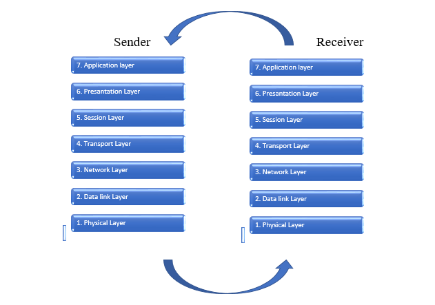
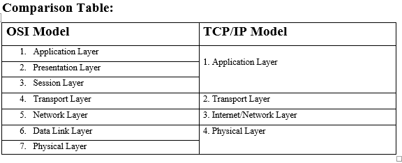
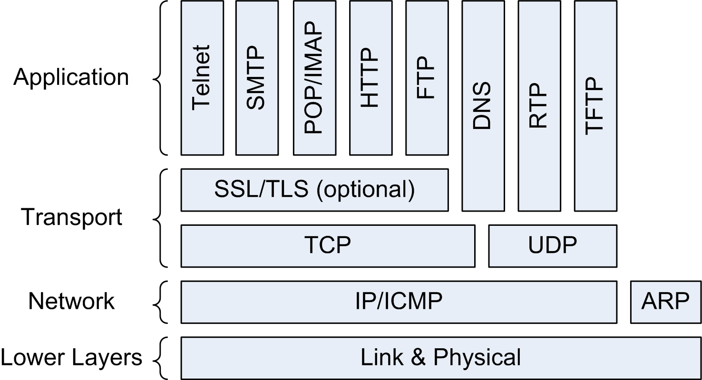
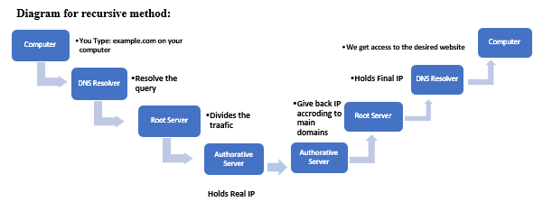
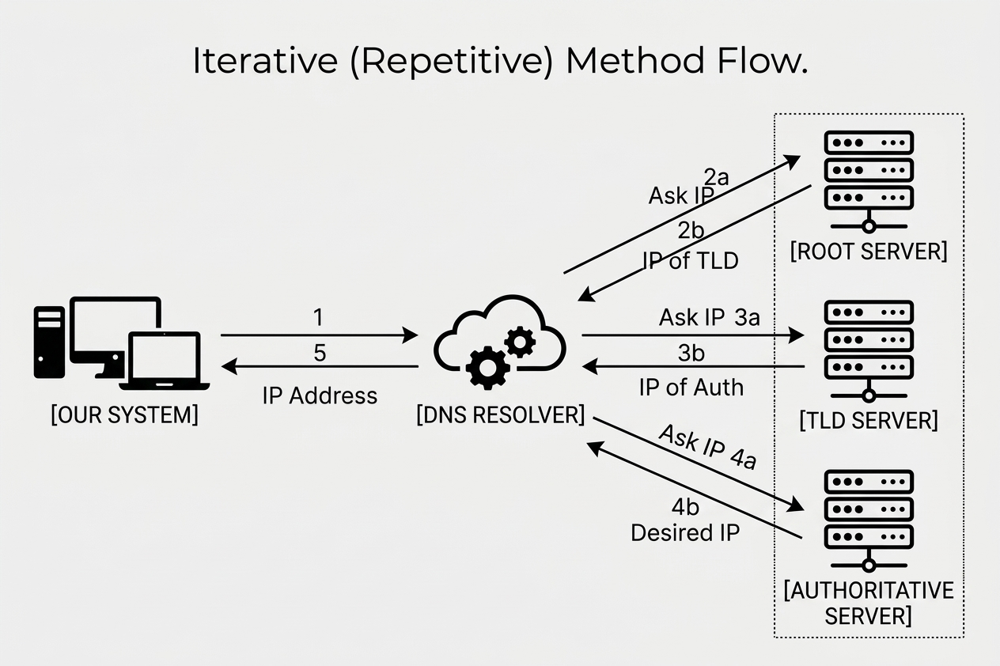
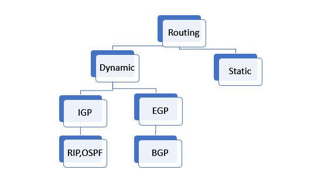
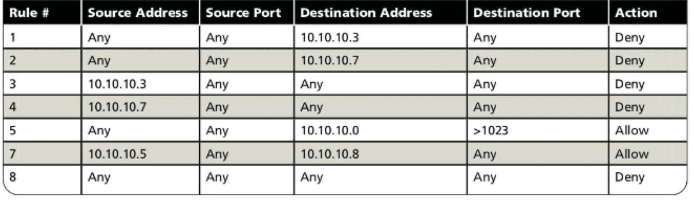

# Networking for Cybersecurity/Ethical Hacking/Pen-tasting

### Table of contents:

*	What is networking actually?
*	Physical devices in a network/Networking
*	OSI & TCP/IP Model
*	IP addressing
*	Sub-netting
*	Broadcast address & Host Range
*	MAC address
*	Routing
*	Switching
*	Ports, services, and protocols
*	DNS
*	VLANS
*	Subnet Mask and CIDR Notation
*	ARP
*	NAT & PAT
*	Network Monitoring Systems
*	VPN's
*	Firewalls
*	IDS & IPS
*	Cloud Security

# What is Network/Networking?
While studying networking, let's first discuss the term' network' or networking. 
A network means at least two or more devices connected with each other to share information and process data. Here, devices connected with each other are called a network.
The process of communication between two or more devices is called networking.
In technical terms, every single device that is present in a network is called a node.
###	Types of Networks:
1.	**LAN:** LAN stands for Local Area Network, which works between nodes that are present in a particular network and connected with wires. No outsiders are allowed to access communication or data from this type of network. e.g., a network of your university lab.
2.	**WAN:** WAN stands for Wide Area Network, which means the Internet we use nowadays to access information or data worldwide. It can also be used to connect two or more LANs
3.	**MAN:** MAN stands for Metropolitan Area Network, which means a network that covers a city, a town, or a particular area that can be from 5 kilometres to 50 kilometres. This is larger than LAN and smaller than WAN
4.	**PAN:** Stands for Personal Area Network, which is used to establish a connection between a single person. e.g., a Bluetooth or NFC connection between a single device or person.
5.	**WLAN:** Stands for Wireless LAN, which is similar to LAN, but connects each node without a wired connection.
Sometimes, a VPN (virtual private network) is also considered a type of network because it allows us to connect to our destination by creating a virtual and private network connection by masks our IP (Internet Protocol) to keep everything private.

#	Network Devices:
In this session, I will discuss the types of physical devices we use to establish our network, enabling nodes to communicate with each other effectively.
For a cybersecurity or ethical hacker, Lerner, it is very important to know how data travels between different devices or networks
1. **Router:** A physical device that routes our traffic to access data from outside (from other LA parts or the Internet) of the network. It decides the best way for data to travel efficiently. e.g., We use a router in a LAN to access the WAN.
2. **NIC:** (Network Interface Card) This is a device or card that gives a system a particular address (assigned during manufacturing), which is used to get data from other devices and send data to other devices or nodes using this address. Modern devices have built-in NICs.
3. **HUB:** This particular device is used to send and receive data between different nodes within a network. The drawback of this device is that when we send a data segment to a particular node, it sends this same data to each node in the network; we get a, huge amount of traffic between devices, causing a slowdown in the network. To control this traffic, we use switches nowadays.
4. **Switch:** This is actually a HUB, but it sends and receives data between nodes or hosts intelligently. A switch has the address of each node in the network. When we send data to a particular node, it will match the address and only allow the corresponding device to receive data. This feature will help us to keep the traffic controlled within a network.

### There are further types of switches.
       * **Circuit Switching:** In Circuit Switching, we turn a full circuit into a path for sending data between just the sender and receiver. During this process, a dedicated path has been established between the sender and the destination address. No one else uses this path until they cut their connection.
       * **Message Switching:** In this type, a network uses a store-and-forward technique in which the whole data set is first stored in the switch and then sent to the destination address entirely at a time.
       * **Packet Switching:** In this technique, data travels between the sender and receiver by creating small segments of data. Each data packet receives the destination address and begins moving without considering the other data packets. 

### There are two types of packet switching: 
       * **Connectionless or datagram approach:** In this method, data packets start to move just by receiving the destination address. Every packet of data uses a different path in the network to reach the destination address. 
       * **Connection-oriented or virtual circuit:** During this, a connection has been established between the sender and receiver. A virtual path has been created, and each data packet should follow this exact path to reach the destination address.
	   
5. **Bridge:** This is used to connect two different LANs so they can also send and receive data within two or more networks. We usually use it to connect two LAN networks.
6. **Firewalls:** This acts as a security element for our network. This decides which devices are allowed to connect to a network and which are not. We use it to establish secure communication within a network. 
7. **Repeaters:** These are used to keep the signal as it is within a network. This acts as a signal booster, which means when we want to increase our wireless LAN range, so when the signals get weak, the repeaters catch these signals and boost them again so the other far devices get the same speed or data Transfer Rate.
8. **APs:** Stands for Access Points, which means when we want to connect our main devices like computers, servers, and printers with wires, but we also want the other devices to access the same network using wireless technology, then we use the APs with our wired router or switch. This creates a wireless broadcast that allows the other devices to connect to the same network.
9. **Modem:** For modulation and demodulation. Modulation is used to convert the computer signals into readable analogue signals for our ISP (internet service provider) so we can access the Internet. Similarly, the incoming analogue signals from our ISP are translated through demodulation. 
10. **Gateways:** This is the entrance point for each network, which is used to translate the protocols. This is most important when we connect our network to another network, which is based on a communication protocol that is entirely different. We can also say this as a translator that translates the traffic of a network according to other network communication protocols. It can be a dedicated physical device or software that is installed on a computer.

# OSI & TCP/IP model:
Now, I will cover the most important topic in networking: 
The **OSI** and **TCP/IP** models.
While studying these two models, it's essential to understand why we examine them in networks.
So today, the modern Internet works according to these models. The OSI model is actually a conceptual model. We just study it to create large networks and know how these networks and nodes are connected, including today's Internet. This provides us with knowledge about the actual functionality of a network. Through this, it is also easy to troubleshoot a network. 
On the other hand, the TCP/IP model is a theoretical and actually implemented model that allows the different nodes in a network to exchange information with each other wirelessly or with wires or even across the globe. 
If we want to understand these two models in one line, then we simply say that the OSI model is for the logical understanding, and the TCP/IP model is for the actual implementation.

In the OSI model, we cover the different **7** layers that interconnect with each other and do their own duty so the next layers receive the data and understand it. 
The TCP/IP model divides the whole network into **4** different layers. Same as the **OSI** model, in the TCP/IP model, each layer can talk with its next layer and the previous one.

##	1\. OSI model:
OSI means Open Systems Interconnection. The word "open" means any device or node in a network that is capable of accessing information or data from anywhere. The word "interconnect" means that the devices or nodes are connected.
In this model, we will study the 7 layers of data processing.
We studied it from bottom to top, which means we talked about the 7th layer first and then the 6th, 5th, and so on. The reason is that, when we send data or a request to a device or something, it starts to proceed in the sender device from layer **7 to 1**, and when the receiver receives the data, the data proceeds from layer **1 to 7**.
The seven layers are:

7\. **Application layer:** This is where the user directly interacts with the application interface to send data or a request. For example, we send an **HTTP** or **HTTPS** request to a web server; here, the interface of the web and our action to send a request and to work on related protocols- all this is handled in this layer. Similarly, for the SMTP request for the email server, the DNS request for domain resolution, etc.

6\. **Presentation Layer:** This layer is responsible for receiving data from the application layer and translating it for understanding between the network. It translates the data according to the application standard. It also handles the formatting of data, compression if data is large, and encryption/decryption of data for security purposes. The common protocols used by these layers are: **SSL** for website security, **JPEG** for conversions, etc.

5\. **Session Layer:** After the data is ready to send, we need to establish a session between the sending point and the destination. The session layer establishes, maintains, and terminates the session. This layer uses the NetBIOS, **PPTP**, RPC, etc., protocols. 

4\. **Transport Layer:** When everything is ready, we need to transport the data or request. The transport layer decides the reliable delivery path and breaks data into packets for safe and faster delivery. This layer also controls the flow of data, error checking and retransmission, and packet assembly. This layer uses two important protocols: **TCP** (Transmission Control Protocol) and UDP (User Datagram Protocol). **TCP** is more reliable than **UDP** because it ensures the data is safe and sent without errors or loss of packets, but it is slower than **UDP**. **UDP** just provides us with fast speed and doesn't care about errors in data, loss of packets, etc. **UDP** is mostly used in live streaming and video calling.

   

  

   
3\. **Network layer:** This is where the data's logical addresses (IP addresses) are assigned to the data for exact distinction. It also handles the best routes for data. The IPv4, IPv6, ARP, and BGP protocols are used in this layer.

2\. **Data Link Layer:** This layer uses the physical addresses of the device for identification or destination. The data here is broken into frames, and frames contain the physical address of the data and the sequence of the data. This layer removes all the errors from the data and makes it ready for final delivery. In this layer, the connection for the physical layer is also managed.

1\. **Physical layer:** Now, it is time to transfer the raw bit stream of data over the physical media. The data is ready to travel through the physical transmission methods. Here, data conversion is also performed: if the transmission medium is a wire, then the data is converted into electrical signals; for WI-FI and fibre optic, the data is converted into waves and light signals.

  

## 2. TCP/IP model:
This model is also called the base of the modern Internet. The TCP stands for Transmission Control Protocol, and IT stands for Internet Protocol. We study the theoretical and practical implementations of a model to establish a network. 
We studied this model in 4 layers from bottom to top, meaning 4th, 3rd, 2nd, and then 1st.

**4\. Application layer:** This layer combines the L7, L6, and L5 of the OSI model. All the processes are the same as in the OSI model. This layer provides the interface between the user and the application, formatting the data and managing the sessions. This also works on the same protocols as in the OSI model layers.

**3\. Transport Layer:** This decides the reliable delivery method of data transmission and works the same as the transport layer of the OSI model.

**2\. Internet/network layer:** This decides for the best routes and manages the logical addressing, same as the network layer in the OSI model.

**1\. Network Access layer:** The functionality of this layer combines the 2nd and 1st layers of the OSI model. This manages the physical addressing and makes ready the data for transmission through the physical media.

# IP Addressing:
Now, we are going to cover another important topic: IP addresses. 
This is also important for discussion, as well as for our device security and the way communication between devices is established, which determines the range within which devices or nodes can send or receive data. 

 **Definition:** 
IP stands for Internet Protocol. Think of an IP address like the return address of your computer that decides how data is sent and how your device or the devices receive data. This is the logical address of your device or each node on the network that is able to communicate with other devices or nodes. When a device tries to connect to a network or device, an IP is assigned to this device so that it can communicate with other devices, and after this, the device will be able to send and receive data. These IP addresses are assigned by an ISP (Internet Service Provider) when we connect to a WAN network, and when we connect to a local network, this task is handled by **DHCP (Dynamic Host Configuration Protocol)**. 
There are 2 versions of IP addresses:
  1.	**IPv4:** 
Internet Protocol version four (v4) is an IP address that is written in **4 parts** and separated by dots or periods, like **198.165.21.3** or **0.0.0.0**. It is a 32-bit number and provides almost **4.3 million** combinations. This version uses a subnet mask that decides the range of this IP address. After some time, with the repeated increase in IoT devices, the world feels the shortage of IP addresses. Then, we need another method of assigning IP addresses with a large number of IP addresses, which is **IPv6**.
  2.	**IPv6:** 
An IPv6 address is written in hexadecimal 128 bit numbers. This is a combination of letters and numbers separated by colons. e.g. **2001:0db8:85a3:0000:0000:8a2e:0370:7334**. It has an infinite number of combinations for human needs.

### There are two types of IP addresses for the IOT devices on the networks:
  1.	**Public IP:** 
When we connect directly to the Internet, the IP address assigned by the ISP is called our public IP address. The ISP has a larger number of IPs, and these are used to communicate and identify different devices on the Internet. When we connect with LAN networks, this address is provided to our router, and then this way, we will also be able to access global information even on a local area network.
  2.	**Private IP:** 
When we connect to a LAN network, we get an IP address which is managed by DHCP. For example, mobile phones, laptops, printers, etc., get an IP address from DHCP. This system works on this process: **DORA**, where **D** means discover, **O** means offer, **R** means request, and **A** means acknowledge.
The system first discovers and checks for the availability of IP addresses within its ranges and then offers them to the devices with an acknowledgement action. This enhances the security and reliability of a network. This is normally best for an office, a university, or a small network. But again, to access the information or data from outside of the network, we need a public IP address, and here, we use gateways and routers, which are used to decide the best path and manage the traffic according to protocols for a network to communicate outside our **LAN** network.

### There are two further types of IP addresses in public IPs.
   1. **Static IP:** An IP address that does not change when we connect again and again to a WAN network. These IPs are normally for servers when we want to host our website personally. This is a permanent IP when it is assigned; Google's IP address is an example of a static IP.
   2. **Dynamic IP:** Our ISP has a large number of IPs. When a device connects to the Internet, an IP is assigned by the ISP, and when the device is disconnected, this IP will be reserved for another device. This IP provides us with another benefit too, by providing an extra layer of security, which means when our IP changes frequently, it is very hard for an attacker when he is trying to track our online activities.

### There are two types of websites' IP addresses:
   1. **Shared IP:** Websites that run on shared hosting plans and get a shared IP address. This means a server that runs multiple websites simultaneously; the websites hosted on this server share a single IP address. This technique is cost-saving and also beneficial for security purposes. But the traffic of a site and the number of pages are limited and manageable.
  2. **Dedicated IP:** Websites that are hosted on a personal hosting server get a dedicated IP address. This is a static IP address and never changes once it is allocated. After getting a dedicated IP, a website is also able to run its own FTP for communication.

### Broadcast Address: 
This is another important thing in a network. This is not a device address or anything else. This is actually the last IP address in your network. For example,

**Network ID:** 198.168.1.0 

**Host ID:** 198.168.1.23

The address at the end of a network is a broadcast address. 

**Broadcast address:** 198.168.1.256

That's why the first and the last addresses in a network are not available for host devices. 

#### Now, why is this important?
Suppose you want to send the same type of data to all the host devices in a network at the same time. We don't need to send this data one by one to all devices; we just send this data to the broadcast address, and it automatically sends to all present devices on a network.

  

The other thing is when a device is lost on a network; suppose a device is trying to find a printer on a network. Now, this is not going to each IP to find out the printer's **IP**. This device normally sends a request to the broadcast address, and the broadcast address shouts out for the printer on the whole network. After this, the printer gives a sign of its presence and shares the IP address with the broadcast address. Lastly, the broadcast address replies to our request by sending us the location or address of the printer on the network.

# MAC addressing: 
MAC stands for Media Access Control. The MAC address and the IP address are two different things. We already discussed the IP addressing in detail above.

We just talk about the MAC address now.

This is a unique **12-digit** hexadecimal address (separated by colons or hyphens) assigned by an organisation at the time of manufacturing. This is the non-changeable physical address of a device in a network. This is very important when we want to communicate with devices in a LAN network. The MAC address works at the **2nd layer** of the **OSI model** to send and receive data between devices. The first **6** digits give us information about the manufacturer, and the last 6 digits identify the network device. 
Examples: 

00:1A:2B – Apple Inc.

3C:5A: B4 – Cisco Systems

AC:67: B2 – Intel Corporation

The full MAC address looks like:

00:1A:2B:3C: 4D:5E (colon-separated)

00-1A-2B-3C-4D-5E (hyphen-separated)

### Type of MAC addresses:
There are 3 main types of MAC addresses:
1. **Unicast MAC address:** When we want a connection between just a server and a device, we use the unicast MAC address. This build connection is actually between two devices in a network.
2. **Multicast MAC address:** When we want to pass a message between a small group of devices at a single time, we use this address. This starts with 01:00:5 and is used normally for streaming, video calling, and gaming. 
3. **Broadcast MAC Address (similar to Broadcast Address):** The MAC address FF: FF:FF:FF:FF:FF is used for sending requests or data segments to each device present in a network at the same time. This is similar to broadcast IP addresses in a network, but this is used only for a local network.
#### Can it be changed?
**Yes,** the MAC address can be changed, but only at the software level. We cannot change the real MAC address assigned by a manufacturer. Some particular software puts a layer of a random MAC address on the original one. Like in Kali Linux, we use the built-in feature (MAC changer) to change our MAC address temporarily at the software level.

# ARP: 
Think of this as a translator between your **IP** address and **MAC** address. **ARP** stands for Address Resolution Protocol, which is a **Layer 2** protocol of the **OSI model**. Suppose you are in a network and want to communicate with another host in the same network. Now you have the IP address of the host, but as you know, within the network, we need the MAC address of the destination host for communication. Now, ARP comes and helps us to find the MAC address of the desired host within a network. We use the ARP request and get the MAC address as a response. ARP sends a broadcast **(FF:FF:FF:FF:FF:FF)**  packet and gets the MAC address of the desired host. 
The packet or request contains the following things: 
1. Your IP 
2. Your MAC
3. Receiver IP
4. Receiver MAC

   **Suppose:**
   
   **Your IP:** 198.168.1.22
   
   **Your MAC:** 00-14-22-01-23-45
   
   **Receiver IP:** 198.168.1.34
   
   **Receiver MAC:**?
   
And here, when the broadcast was received by each host,  the host replied (by sending its MAC) whose IP matched the IP in our request, and finally, we got the MAC address.

Now, suppose you want to know the MAC address of a host outside of your network, and then, in this case, the scenario will be different. This means the source and the destination will connect through routers. 

### Types of ARP:
1. **Proxy ARP:** Suppose there are two networks A and B. A host in network A wants to send a data packet to a host that is in network B. But network B doesn't want to share the MAC addresses of its host devices. Here, network B uses the proxy server to hide the MAC addresses of all host devices. When the host from network A sends an ARP request to the proxy ARP router, instead of sending the destination MAC address, the proxy server sends its own MAC address and handles the further communications on behalf of the destination in network B. This is mostly used for security purposes.
2. **Reverse ARP:** This is actually a normal ARP method but in reverse order, meaning if you have the MAC address of a host device but want to know its IP address, then we use RARP. The source adds its MAC and IP address and the destination MAC address in a request. In response, the receiver sends back its IP address. This is used to update the cache table to handle duplicate IP addresses.
3. **Dynamic and Static ARP:** In dynamic **ARP,** the entries are added by the software automatically, while in static ARP, the administrator writes each IP address with its corresponding MAC address.
4. **Gratuitous ARP:** In gratuitous (without reason) **ARP,** the host asks for the MAC address of its machine. This means it sends a request to the whole network with its own IP address and demands the MAC address. In response, he gets the **MAC address** of his machine. This method is used to announce his own MAC address to the other host or update the cache table.

# Subnet Mask and CIDR notation.
These are two techniques for doing the same job.
1.	**Subnet mask:**  
The subnet mask decides the range and size of a network. It divides an IP address into two parts.
The first three octets (e.g., 198.2.21) decide the network address, and the last part tells us the host number. A private IP address also has a subnet mask, which ranges from **0.0.0.0** to **255.255.255.255.**
This is the hidden part of an **IP address**. Need for a subnet mask because our systems only understand the data in 0s and 1s form.  For example, the IP address is **198.168.1.50**, and the subnet mask is **255.255.255.0**. When the request goes on the network, this mask is translated into 0s and 1s form, like for a subnet mask **255.255.255.0**, the binary form is **11111111.11111111.11111111. 00000000.** To know about the range of a network, we count the 1s in binary data, which tells us, actually, the size of our network. Like in previous binary numbers, we have **24** 1s, which tells us this is a small network, like for a home or for a small corporate office. If we look at the previous IP address, part 198.168.1 is the network ID, and the next number, like 50, is the host ID in the network
2.	**CIDR notation:** 
The CIDR stands for Classless Inter-Domain Routing. We need this **CIDR notation** because writing a subnet mask after an IP address is not good practice. This method converts a whole subnet mask in binary to a single- or double-digit form. Like in previous examples for a subnet mask **255.255.255.0**, when we convert it into binary form, this becomes **11111111.11111111.11111111. 00000000.** So we see this is too long for practical writing. So, the CIDR notation gives us a method to count only 1s in a binary string. As if we count the 1s in the previous binary form subnet mask, which is **24**, we write this number with an IP address that tells us the IP of a host as well as its range or size. Like the IP address 198.168.1.50/24, the last digits 24 are the size of a network.

  

# Sub-netting:
The process of slicing a huge network into small pieces is called Sub-netting, and each network is called a subnet. Think of this as a network of a huge company that offers 200 connections, but connecting **200** devices with a network at a time becomes messy. We use the sub-netting technique and divide this whole network into small pieces, like two networks for each 100 host devices. This technique helps us establish better communication between devices and maintain security. 

But here again, we use the subnet mask that describes an IP address with two parts and also tells us the range and number of **IP addresses** that would be offered by a network. It tells us where the host ID starts and where the network **ID** ends. When we divide a network, a subnet mask borrows a bit from the previous network and creates a new one. 
#### Like:
**IP address is:** 198.168.1.50
        
**The subnet mask is:** 255.255.255.0
                                                        
After dividing it into two networks, it becomes two subnets.

**First subnet network ID:** 198.168.1.0
                                                        
**Second Subnet network ID:** 198.168.1.128

After this, the subnet mask will be:

                                                First network mask: 255.255.255.128        
                                                Second network mask: 255.255.255.128

### There are two methods of dividing a network into subnets:
1.	**FLSM:** 
The Fixed Length Subnet Mask divides a network into equal parts. Think a network offers **50 connections**, and when we convert it using the FLSM technique, it will divide this network in equal two parts, which means 25 connections for dividing this network into two parts. This is actually not a good practice because when the other network needs only **2 or 3** connections, then the remaining connections or IP addresses become useless, and still, this is not a good network.
2.	**VLSM:**
 In Variable Length Subnet Mask, we divide a network according to the exact needs of the network. This means that if we want to create two networks, the first needs **40 connections**, and the second one needs **60 connections**, and our total network capacity is **100** connections, then we divide this network using the **VLSM** technique. 
Before this technique and CIDR, we divided a network using the rigid classes technique, in which we divided a network according to A, B, C, D, and E classes. Here

A = A huge network that offers more than 16 million IPs for its devices.

B = A medium network that offers almost 65000 host IPs.

C offers almost 256 connections or IPs, and the other D and E are used for smaller networks. Before sub-netting, this technique fails because suppose a network working with 256 host devices, and now the company has grown and wants to buy an upgraded class network, which is class B, which offers **65000 host IPs**. Now, here, these may be too large for the present devices. Sub-netting solves this for today's modern networks.

**Host range:** 
The number of IPs that are usable for host devices like your router, mobile, printer, etc., is called the host range. In a network, the first IP is the network ID, and the last IP is the broadcast address. All the middle IPs are for the host devices, and this is also the host range.

                                            Network ID: 198.168.1.0 
                                            Subnet mask: 255.255.255.0
                                            Host range: 198.168.1.1 to 198.168.1.255.
                                            Broadcast address: 198.168.1.256 

# Ports, services, and protocols:

This is another important concept in networking and cybersecurity/ethical hacking. During scanning a system, this plays an important part in knowing which types of vulnerabilities and services exist. Ports and protocols allow us to collect some important information like version, open ports, etc., about the system.
1.	**Ports:**
 Think of ports like a room inside a building. This is the part of an IP address. You can also consider an IP address as a building and the ports as rooms inside the same building. There are almost **65535** total ports that exist in a system. Actually, every single service is like watching a video on YouTube, chatting with friends, getting mail from the office, etc.; it uses a different port or room in the building. Multitasking on a device is actually possible through different ports in a system. Some common ports in a system are 443 for HTTPS traffic, **8080** for **HTTP** traffic, and **25** for **SMTP**. Each port uses a specific protocol.  
There are almost 0 to 1000 well-known and mostly used ports in a system. From **1025** to **49151**, registered ports are used by applications; for example, port 8080 is an alternative to HTTP, and **3306** is for MySQL Server. The ports from **49152** to **65535** are used by the client side. Like you getting a response from a server. 

Some common ports are:

                                                Ports     Services
                                                 20       FTP Data
                                                 21       FTP Control
                                                 22       SSH
                                                 23       Telnet
                                                 25       SMTP
                                                 53       DNS
                                                 80       HTTP
                                                 110      POP3
                                                 143      IMAP
                                                 443      HTTPS

2.	**Protocols:**
These are sets of rules and regulations used by a port that can send and receive requests. Think of this as a specific language used by a port when communicating with other devices. The number **443** is the port number, and **HTTPS** is the protocol used to load a website securely. Similarly, **TCP** and **UDP** are the transmission protocols used to communicate between devices. For sending mail, we use the **SMTP** protocol, and for converting the domain name to
the IP address, we use the DNS (phone book), and so on.

  

These protocols are responsible for reliable and secure data movement by checking for errors, lost packets, retransmission, and ordering the data.

The TCP protocol is connection-oriented and uses a three-way handshake technique to talk with a device. 
Send a **SYN** request and get an **ACKNOWLEDGEMENT** with **SYN** and then send another **SYN** for ready to connect. We use it when we need perfect data. This is much slower than the UDP use for when data is important, like sending an email or chatting with a friend.
On the other hand, when we all focus on speed, we use the **UDP** (Connectionless) protocol. Here, the protocol doesn't care about the order of packets, retransmission, or error checking; it just sends data speedily. This is used for video calling, live streaming, live games, etc.

3.	**Services:**
 When we send a request through a specific port using a specific protocol, the other side, which is waiting for the connection, is known as a service. This is actually a running task on the server side. Like in the **HTTPS protocol**, the web server is waiting for the connection, and the process running during this is called a service. 
For example, we want to send an email to someone, and the process will be:

**Port:** 25

**Protocol:** SMTP

**Service:** The mail server is ready for further processing
Some common services and protocols are:

                                            Web Server                     HTTP              
                                            Secure Web Server              HTTPS
                                            SSH Server                     SSH
                                            Mail Server                    SMTP
                                            DNS Server                     DNS

# DNS:
Now, we will discuss about the DNS, which is essentially a book that maps IP addresses to their corresponding names. DNS stands for Domain Name System. Before DNS, the only way to browse a website or information on the Internet was to use the corresponding IP address to visit the specific site. After the repeated increasing of the website in the whole world, it becomes difficult to remember the IP address of each one. The human mind interacts with pictures and letters easily, but remembering numbers, especially when there are too many, becomes difficult. After that, the system of domain names was introduced, where we gave a unique name to every IP address. To find a domain by its name, we use the Domain Name System(DNS), which is responsible for giving us the IP address of the corresponding domain. 
Let's suppose we try to access the Google.com website. There are two ways to access this site: one by its name, the second by its IP address (8.8.8.8). 

When we try to access it by its name, the DNS system works for us to convert our name into the corresponding IP address and gives us back the IP to access the information inside this IP(website). 

This process only happens when we try to access a website for the first time because a memory in our ISP has the IP address of the recently visited website, which is called cache memory. 

Let's suppose we want to access the example.com website for the first time; then this process happens in two ways: the recursive method and the iterative method. 

1.	**Recursive Method:**
 Suppose you want to access example.com. When you type the name of the site, the DNS resolver takes your query and forwards it to the Root Server. The root server further starts to read the query from right to left, which means the .com gives the direction or address to the Root Server to the next destination, which is the **Top-Level Domain**. Here, the tasks are divided according to the top-level domains. Like .com, .edu, and .pk are top-level domains, for each, a query takes place in a different box where the .com is present; similarly for .edu and so on.  After this, the top-level domain reads the query and sends it to the Authoritative Server, which holds the real IP address. This gives the real IP address back to the top-level domain; the top-level domain gives this IP address back to the root server; the root server gives the IP back to the DNS resolver; and finally, the DNS resolver gives this IP back to us.

  

2.	**Repetitive (iterative) method:** 
In this method, the same server works differently. When we send our query to the DNS resolver, it asks for the IP to the root server. The root server doesn't know the IP address, but it knows the IP address of the **TLD server**. The root server gives back (to the DNS resolver) the IP of the **TLD server**. Again, the DNS resolver talks with the TLD server for the IP address. The **TLD server** gives it back the IP of the authoritative server. Finally, the DNS resolver contacts the authoritative server to get the **IP address**. Here, he got the desired IP address and gave it back to us. 
This means that in the iterative method, the whole query is handled by a DNS resolver, which resolves the query step by step by making a fresh query again and again until it gets the IP.  
**The diagram will be:**

  

# Routing:
Now, we discuss how traffic actually moves between different networks or within a single network.
This is another important concept in networking, where we discuss how data travels between networks or within a network. 

**Definition:** The word routing means choosing or deciding the best and shortest path to travel data between different networks or access traffic outside the network. The router uses a default gateway to send and receive data from outside of a network. 

### Why do we use routers?

Think of a router as a device that helps in communication between different networks. Suppose 2 computers, **A** and **B**, want to communicate with each other.

**Computer A IP**: 198.168.1.21

**Computer B IP:** 198.168.1. 23

Now, as you can see, the network part is the same, meaning both computers are on the same network, and we don't need to use a router here. We simply use a switch or a hub.
**Now, Suppose:**

**Computer A IP:** 198.168.1.43

**Computer B IP:** 198.168.1.21

Here, the network parts are different, which means both are on different networks, and here, we actually need a router that uses a routing table to determine where data goes if the device is outside the network. In the routing table, he found the destination address, the next hop, and the default gateway (exit door) that helps a router to understand the destination of the packets accordingly.

### There are two types of routing methods: static routing and dynamic routing:
1.	**Static Routing:** 
A routing method in which a user decides which path should be used for a device to communicate with devices outside the network. In static routing, we have options to customise the routing table. This is useful for small networks but not a good practice for large networks. In a static routing table, the admin decides which path can be used by which device on network; then we are restricted to use only these paths, even if other better ones are available. In the routing table, we set the destination address, the subnet mask, the next hop, and the exit interface

**Example:**  Route to **10.0.0.0/24** via **192.168.2.1** means the for the device **198.168.2.1** a path sets which is **10.0.0.0/24**

2.	**Dynamic Routing:**
 Here, the software itself writes the routing table and makes decisions that the device should use, which path to use for communication, using the same type of protocols like **OSPF, RIP, BGP, etc.** 
Here again, we have two types of dynamic routing protocols, IGP and EGP:

  *	**Interior Gateway Protocol (IGP):** 
The network that uses dynamic routing techniques inside a network or between small networks uses IGP protocols like RIP, OSPF, etc.
RIP: Stands for Routing Information Protocol, which uses purely the hop count to decide which path should be used. RIP tries to select the shortest hop count for the movement of data packets. The word “hop count” means how many jumps it takes for data packets to travel from one network to another. Suppose a network wants to send a data packet to another network. 
This network has two paths, **A** and **B**. In path A, we have **5** hop counts (routers), and in path **B**, two hop counts. Here, the **RIP** protocol chose path B even if it is slow because it uses fewer hops. 

     **OSPF:** Stands for Open Shortest Path First. Here, as this is sounds like, he chose the shortest path first, then the other, if         this is not available. 

  *	**Exterior Gateway Protocol (EGP):**
EGP is used when we want to connect two different large networks. This is mainly used to connect different WAN networks for the exchange of data packets. Like our ISPs use the EGP to communicate with each other. The only protocol used in this type is **BGP.**

     **BGP** stands for Border Gateway Protocol. This is a very powerful protocol used to connect different large companies' networks. It      uses special technologies to handle millions of routes at the same time. The main reason behind the only protocol used to connect         huge networks is that, it is very important while connecting different large network, to speak the same language, when the protocol       is different we get trouble to make communications.

  

# Switching:
Now, we are going to talk about the data movement within a LAN network. This means that a switch is used to connect different hosts within a network. This is a Layer 2 device and connects different hosts that communicate using a Smart Switching Table or CAM (Content Addressable Memory) table with each other. The alternative to switches is a traditional hub, which is used in a LAN network, but the problem is that when we have to send a data packet to a particular host, the hub broadcasts this data to all the present hosts in the network. The switch solves this problem and sends data packets only to the particular host whose **MAC** address matches the MAC address in its switching table. All the communications within a network are made by using the physical MAC address. 

Now, let's suppose two computers, **A** and **B**, are in a network. Computer A wants to send a data packet by putting its MAC address in the header of the data packet. The switch receives this data packet and forwards it to the destination host. **But what if the switch doesn't know the MAC address of the destination host?**

Then here comes the concept of Unicast Flooding.
* **Unicast Flooding:** In this technique, the switch receives the data packet and creates a copy of the data. After this, it broadcasts this data to all the devices in the network, except the one it came from. The destination device responds to this data packet and sends a green signal back to the switch. In this process, the switch finds the unknown MAC addresses and updates the CAM table for the next time. 

#### Types of CAM or switch tables:
1.	**Static CAM:** 
The switch table is managed by an administrator. He enters the device's MAC addresses and the port numbers manually. Because we need two things for communication. The port number and the MAC address.

Like: 

MAC:  AA:BB:CC:11:22:33 (PC-1)

Port:   1 

2.	**Dynamic Switching CAM**
In dynamic switching, the CAM table is managed by the software itself by using these three ongoing phases:

**A. Learning phase:** Whenever a device connects to the switch and sends data packets to other devices, the switch learns about the MAC address of the destination and the source, and adds it to the CAM table for the next time. 

**B. Flooding:** This is actually unicast flooding, which means the switch finds the unknown MAC address by sending a copy of data packets to all the host devices and specifies the port numbers also. 

**C. Forwarding:** Once it finds the MAC address, it also adds its port number so that if another host wants to communicate with this host, the switch skips the flooding process completely.

### Different modes used by the switches: 
These are techniques that switches use to enable communication between different hosts.

* **Cut-through mode:** When the switch sees the **MAC address** of the destination host, it immediately sends the whole packet without waiting for the remaining data packets. It reads that the first **6 bytes** are the MAC address and starts the forwarding process.

* **Store and forward mode:** In this technique, switches first store the data and then forward it to the desired destination host. This helps to check errors in data packets because when data is stored, it automatically checks for errors and then forwards the data.

* **Fragments-free:** In this mode, the switch reads the first **64 bytes** of data and then forwards it without creating fragments of data. In Ethernet networking, the minimum healthy size of data is the first **64 bytes (512 bits)**. If there are any errors in the data, these are highlighted here, and the data is broken into tiny pieces called runt frames. These are considered garbage in data.

### Collision Domain: 

The area or section where a collision happens when two devices start communicating through one shared line in a network. Think of this as a single one-line bridge. A car starts moving from the left side, and a car comes from the right side, and both collide in the middle of the bridge. Similarly, a data collision occurs in the middle of the shared line, and the data is lost in this instance. 

However, the modern switch solves this issue by dedicating a single port to a single host, ensuring accurate and fast movement of data without packet loss. 

# VLANs: 
Stands for Virtual Local Area Networks. We actually isolate one physical LAN network into multiple virtual LAN networks. We set the number of host devices in each virtual network. 
**Example:**

Suppose you are in a building where almost **60** host devices are connected through a switch and communicate with each other normally. Here, you have **10** host devices for **HR**, **10** for the **product managers**, and the remaining for the **IT desk**. 
As you know, sometimes we have to broadcast some type of data packets in a network, like ARP requests; then all the host devices get this data and process it accordingly, but what if the data just relates to the **IT** department or HR department only?

Or if you don't want the other hosts to receive this data for security concerns, then here **VLANs** come in. 

By implementing VLANs, we turn one physical **60-port switch** into three separate virtual mini-switches. HR, Product Managers, and IT each get their own private network sandbox. They get full privacy, and their local network traffic never leaks out to disrupt the other departments.

#### Why is this best for security purposes? 
Suppose a hacker gets access to the guest **Wi-Fi** or one part of the VLAN, and then it's not a big deal for the hacker to reach the company server. But what if we isolate the network between the guest Wi-Fi and put a strong layer so the users or hackers don't cross it easily? Here are the VLANs that help us to do this task easily. 

* **VLAN ID:** 
Every virtual network has its own special ID called the VLAN ID. For example:

**IT department:** VLAN 40

**HR department:** VLAN 10

**Product managers:** VLAN 10

#### Can a host from the HR department communicate with the host in the product manager department? 

So the answer is no, because this now becomes a separate network, and we need a router or Layer 3 switch for data sharing to the outside from a virtual network. This is also called inter-VLAN routing. 

* **Access port:** 
A port where you can access all the host devices within a virtual network. The HR department has an access port from which we can talk with all the hosts inside the HR department VLAN. 

* **Trunk port:**
A physical port that connects all the VLANs in a physical local network through a single line. Think of this as a bus topology, where all the host devices are connected to one main line. Similarly, here, all the virtual networks are connected to one main line called the trunk port.

# NAT & PAT
Now, we will discuss the routing process in today's modern routers. We will cover how private and public IP work together to give us access to the global Internet.

*	**NAT:** Stands for Network Address Translation. This is the process of changing the IP addresses while the data moves between networks. Suppose you are on a local network where you have a private IP address, **198.168.1.50**. When you want to access a website using your private **IP**, the request goes from your router to the desired web server. When the server tries to respond to the related IP address, it isn't able to map the IP address, which means it doesn't know about your private IP because the private IP address only works within the network. 
Here, **NAT** solves this problem and converts a private IP address to a public IP address so that you will be able to access the Internet. Actually, your router has only one public IP. When you send a request to access the Internet, the request goes from your mobile to the router. The router remembers your private IP and puts your request on the public IP address. After getting the response, the router again sends you the response by matching your private IP address.

**Private IP:** 198.168.1.32 (Host) <-->  **NAT** <-->  **Public IP:** 175.23.1.45 (Router)

When the desired website sends the response back, NAT again changes the public IP to a private IP, and the router sends the packet accordingly. 

#### But in NAT, we have a problem: 

Suppose two devices, A and B, are on the same local network, having private IPs 
**198.168.1.50 and 198.168.1.52**

Now, for example, both host devices want to access the same website at the same time. The query goes to the router, and **NAT** translates their addresses to one public address. But when the website responds, the router gets confused about which packet belongs to which host device. Because the website only sees your public IP.

* PAT: Here, the advanced NAT means PAT (NAT overload) comes in. This stands for Port Address Translation. 
This technique translates your private **IP** to the **public IP** as well as assigns a unique port number. This port number will also be changed when the router gets a response back from the server, and this is known as the outside port number. 

Now, let's suppose two hosts, **A** and **B**.

                         
                         Systems	        Inside Private IP	       Inside Port
                         
                           A	              198.168.1.3	              4100
                           B	              198.168.1.21   	          4100

#### After PAT translation:

                        Systems	            Outside Public IP	       Outside Port:
                        
                          A	                  23.43.155.21    	          10001
                          B	                  23.43.155.21       	      10002

#### After getting a response back:

Destination **IP** 23.43.155.21: **10001 and 10002**

By matching the port number at the router end and again translating the IPs, both packet sets are delivered to the same outside ports. 

Here, if you see, the inside port 4100 for both hosts is the same. That's why assigning unique outside ports is crucial. Otherwise, the packet is again lost due to unclear destination ports. This happens commonly when we try to browse the same type of service; the outgoing service uses the same ports by default. 

Here, the port number is a specific room number, and the **public IP** is the house number. This means two systems with one public IP address get a response from the Internet simultaneously by attaching the port numbers. 

### Why is the port number important?

System A wants to access **Google.com** by having the public IP **23.43.155.21** and port number 4300. Similarly, System B wants to access **Facebook.com** by having the same public IP and port number 5400. When both servers send a response back, the traffic will be divided according to the port numbers. So, systems have different responses. 

To conclude the **PAT**, this is a process using one **public IP** address by many devices and separating them by giving unique port numbers to use the connections.

# VPNs:
This is also an important topic because most enterprises and companies worldwide use VPNs for secure data transmission between users and the company database. This also helps to put a security layer between two different networks. 

### Definition: 
A Virtual Private Network **(VPN)** is the process of encrypting data and making a secure connection through a secure tunnel so that the data remains secure from the outside network or the Internet

Suppose you are connected to your local network or to a library network, and you want to access sensitive information from the Internet, such as performing a bank transaction. Here, any other person on the same network can steal your credentials and track your online activities.
#### The request process will be:

                                            Your Phone --> Internet --> Bank server 
But here, a VPN helps us and keeps our online records secure by making it encrypted and establishing a secure connection through a tunnel.

After activating a VPN, the request process will be:

            Our device --> VPN --> Encrypt the data --> Pass through a secure tunnel --> VPN Server --> Destination

#### This is how a VPN works, actually.

### Important terminologies related to a VPN:
1.	**Encryption/decryption of data:** The process of changing readable data into an unreadable form is called encryption, and changing this same unreadable form to readable data is called decryption. A special key is used to decrypt this data. Both processes are handled by the VPN application automatically. 
This is a similar process on modern social applications, like WhatsApp, which offers end-to-end encryption, which means no one can see your data except the sender and the receiver.

The VPN does the same job; it encrypts our traffic and makes it more secure so that if anyone gets access to the data, it is useless until he gets the decryption key. 

#### Something looks like:

                            Non-encrypted data	           Encrypted Data
                             
                             Username: Zohaib             Username: $%19@$!%14
                             Password: Zohaib1234         Password: %$td_€twi%#
	                                                                                                            
#### We need a spatial key to see the encrypted data in its original form. 

2.	**VPN tunnel:** This is the path through which our data moves from source to destination. Think of this like a highway where cars move normally, but a special care-packed in a big container moving towards the destination; no one can see the car inside the container; they see the container only. Similarly, the VPN tunnel wraps our data in a tunnel so that no one on the same network can access it. 
If a network operator scans the network, they can see data packets moving, but he doesn't access the data inside them. 

#### There are two types of VPN tunnels:

* Split Tunnel: Suppose you want only the specific data to move through the VPN and the rest of the data to move normally. This             means you want to access the company database; the only data packets related to the company database pass through the VPN, and            the other packets move normally without VPN integration. This becomes less secure if the configuration doesn't apply                      accurately. 

With Split Tunnal (VPN):

                         Data Related to the company --> VPN  --> Company server (Destination)

Other traffic on same device:

                         Our data --> ISP --> Destination
						 
* **Full tunnel:** All of your traffic will move through the secure VPN tunnel
  
                         Our data --> VPN --> destination

3.	**VPN Server:** The place where our data moves after leaving the source host. When we access sensitive data, the data is encrypted before moving to the **VPN server.** Here, data is decrypted and forwarded to the desired destination. This provides an extra layer of security because our ISP or network provider don't know about our location because they see the data originating from the server of the VPN.

#### This means it changes our location also.

                               Computer ----> Encrypted VPN Tunnel ----> VPN Server ----> Destination

4.	**Authentication:** This is the process of checking which users actually get access to the particular data. It integrates the password and username before the user uses the VPN service.

### Main Types of VPNs:
•	**Remote Access VPN:** This is a type of VPN that provides a secure connection within a local network. This is normally used for remote tasks. Suppose you are at home and want to access your company server remotely. Then, you need a remote access VPN for a secure connection.

•	**Site-to-Site VPN:** This is used when we want to secure all the traffic between two different networks. Enterprises and companies use it between their different branches for secure communication. This is also called router-to-router VPN because when we connect two networks, we need a router on both networks; this VPN is placed between these routers for secure VPN based communication. 

                                                 Router 1  --->   VPN  --->  Router 2

### VPN protocols:
Think of these as the protocols in a network work for, how data moves, and how connections are made by using specific rules and regulations. Similarly, the VPN protocols decide the delivery of data, encapsulation, encryption, and tunnelling, and decide which ports should be used. 

The VPN and the Protocols are two different things; the VPN itself provides us with an infrastructure and guides the system on how this works when a device or network tries to connect.  While the protocols are the inner system that handles the actual connection. 
Some common protocols, such as **PPTP, IPsec, OpenVPN,** and **WireGuard,** are used by modern VPNs.

### Features/benefits of using a VPN:
1.	**Secure Connection:** By using a VPN, we can browse the Internet without being tracked. VPN wraps our standard online traffic into a secure tunnel, and through the encryption process, it makes it unreadable for our Internet provider. Suppose someone gets access; they still need a special key to decrypt this data to make it readable. 
VPN also masks our IP into a public IP address that points to the traffic coming from the VPN server, which means protecting our location, IP address, and data packets on the Internet. 
2.	**Bypass Region Restrictions:** VPN also provides the benefits of getting access to the kind of data that is not available in our region by changing our location. This means it masks our IP and is set according to where the particular content is available. 
3.	**Site-to-Site protection:** Suppose your company has two networks, he want a secure communication between these two networks. VPN provides this facility and also creates a secure communication channel between two networks. 
4.	**Remote Access protection:** Suppose you are at home and want to access your company database, or your company demands work from home, then the VPN again helps the user by providing a secure private connection for remote work. 

### How a VPN actually works?

The VPN works in four steps whenever a device tries to connect to the Internet through the VPN.
1.	**The digital Handshake:** When we open a VPN application and push the connect button, the process behind this button is actually a digital handshake. In this process, the user asks for the VPN server to use the connection protocol service, like AES 256(encryption standard). After this, the VPN and our device both make a cryptographic symmetric key that is used to encrypt and decrypt the data at the server and the user end. 
            Both share public keys, and the VPN starts to serve. 
2.	**Encapsulation:** This is the process by which the VPN wraps our data in a secure tunnel so that no one on the same network can access it. By putting an extra layer of security on our original data packets, encapsulation makes it non-traceable by other users.
3.	**Encryption:** In this step, our data turns into a raw format and becomes unreadable without a special key, which was generated at the handshake process. This uses a symmetric protocol to encrypt data like **ChaCha20** or **AES 256**, which is used to generate the unreadable cipher text 
4.	**Decryption and forwarding:** Again, when data is ready for forwarding, this raw data turns into the original form and becomes exactly like when it was generated from the user device. The destination gets the original data packets, and when the VPN gets a response back, the encryption/decryption procedure works inversely.

# Firewalls:
This is another important software or device for network security. We use firewalls to keep our network protected from unauthorised access. We monitor all traffic and set rules to drop and reject connections. 

**Definition:** 
A wall that is placed between the access port and the external network traffic(internet). This is essentially a security guard for the entrance gate of your network, which checks all incoming/outgoing traffic and filters it according to predefined rules set by administrators. 
Basic firewalls can check only the packet headers and allow data movement by checking the IP address and Port Numbers, but modern firewalls offer **Deep Packet Inspection (DPI)**, which provides the facility of checking the actual payloads inside the incoming/outgoing data packets.

#### The firewall placement in a network will be:

         -------- Internal traffic (LAN network) ---------- Firewall---------External traffic (Internet)--------

### Host firewall and network firewalls: 
This can be for a single host and for a whole network. The Windows firewall by Microsoft on our computer is actually software that helps to block the malicious traffic from external sources. 

The network firewalls can monitor the whole network and provide us with comprehensive features to customise the incoming/outgoing traffic. This would be software, hardware, or a mixture of both. For the best security experience for a network, we use dedicated hardware firewalls and manage its thorough dedicated **OS**. 

### Types of firewalls: 
#### 1.	Static Packet Filtration Firewalls:
This is the most common type of firewall at **layer 3** (OSI model) and is also known as a stateless firewall. This means it treats each incoming/outgoing packet separately, even if the packets' destination/source addresses are the same every time. It manages the connections only by checking the headers of the packets. In packet headers, it checks:

* Source IP
* Destination IP
* Source Port
* Destination Port
* Protocol type
#### It can block specific IPs, ports, and protocols. 

**Suppose:**

  

The word **Drop** means to reject the packet without sending the signal to the user, and **Deny** or reject means to reject the packet and also inform the user with an error message. 

#### 2. Stateful inspection firewall (layer 4):
This firewall uses a state table that holds the record of the active connections and allows the incoming traffic based on the outgoing traffic.

                                            User     <---->      Firewall     < ----->     Google.com

	
means the user sends a packet towards the Google server, and obviously, when Google replies, the traffic will be authorised, and the firewall will check the state table and allow the incoming packets automatically. This is less secure because it keeps an eye on the active connections and doesn't care about the payloads or actual data inside packets. 

#### 3. Proxy firewalls: 
This is the layer 7 firewall. It is placed between our network and the external network. Instead of each traffic going directly from your device to the destination, the firewall catches this first and checks for the authenticity of data packets, and then these forward the destination.
                             
This means that all the outgoing traffic and incoming traffic must interact with the firewall first. No one knows about the internal traffic.  This can perform packet filtering as well as handle other protocols like **HTTP, DNS, HTTPS,** etc., at the application level. 
#### 4. Next Generation firewall(NGFW): 
This is the firewall that is used by enterprises nowadays. This provides each and every feature that is useful for network security. From basic packet filtering to deep packet inspection, intrusion detection, packet analysis, link filtering, and virus/malware detection. 
This provides comprehensive security features and covers the **3** to **7** layers of the **OSI model.**

#### 5. Hybrid Firewalls:
This combines the **2** or more firewalls in a single **LAN** network. This provides us with multiple security features for each virtual LAN in a single physical network.

### Working of a firewall: 
1.	**Monitor traffic:** The firewall monitors the incoming/outgoing traffic and decides which allows the network and which does not, according to the rules of the firewall. It can check the packets for basic filtering and perform deep inspections to detect unauthorized access and malicious payloads. 
2.	**Rules check:** After checking the packets, the firewall checks for the rules of data movement. The rules tell the firewall which type of traffic should pass and which type of traffic should not. These can be customised by the administrator and set by default.  
The default rules:

       • **Allow rule:** Allow the specific traffic and block all the other traffic, incoming or outgoing. This is more secure
           Suppose a fire in a firewall the source port **443** is allowed. It allows only **HTTPS** traffic for the network. All the                other traffic, FTP, HTTP, SMTP, etc, will be blocked automatically.
  	
       • **Deny Rule:** This is the opposite of the Allow rules, which means it denies only the specific traffic and allows all other                traffic to carry about the payloads inside the data packets. This is less secure, that's why.
  	
  	   • **Drop rule:** This rejects the traffic without showing any error to the user. 
 
4.	**Action:** After checking the rules, the firewalls allow, drop, and deny the traffic according to the rules.

### How hackers can abuse the firewalls:
Firewalls set the security policies for inbound and outbound traffic, but still, the attacker can intercept the traffic and steal the data.
1.	**Weak configurations:** Sometimes, the administrator sets the wrong rules or mismatched rules, and the attackers, by continuously performing different types of attacks, find cracks in the weak configuration and enter the network.
2.	**DoS attacks:** Suppose an administrator allows HTTPS traffic. The attacker sends the HTTPS request continuously until the software or hardware firewall crashes. After this, he can enter the network easily.
3.	**Security patches:** By finding the vulnerabilities and loopholes in the firewall software, the attacker can hack the firewall, change its rules, and interrupt the traffic. That's why we immediately update the software and continuously check the rules.
To conclude, the firewall is a basic and fundamental need for network security. The repeated increases in digital networks and remote networking require us to use firewalls to prevent unauthorised access and manage the incoming/outgoing traffic.

# IDS and IPS:
Now, we are moving towards advanced network security. The previous security software or devices were firewalls, which we covered so far, but in this security operator, we have a problem: the firewalls check the packet headers and payloads and give access to enter the network according to predefined rules.

An attacker puts malicious code in an authentic service like HTTPS, SMTP, etc, and bypasses the firewall security. The attacker bypassed the firewall by sending too many requests from the same system. Now, we have advanced security operators who can secure a network by providing more control over network security. 

### 1. IDS:  
Before we move, let's understand what **intrusion** means. Unauthorised access that tries to steal, damage, and misuse the data from a computer system or a network.
**IDS (Intrusion Detection System)** 

This is a system that helps detect unknown or unauthorised attempts to enter a system or network. This only detects unknown entries, like someone trying to compromise the system or trying to steal data, etc, and informs the administrator. This system does not protect the network or device by itself. 
Think this is like a person who gets locked inside a room, and he doesn't have keys; he just shouts out for help; he doesn't unlock the door itself. Similarly, this system just warns the administrator but doesn't stop the attacks. 

#### Placement:

                                          Internet       --->    IDS     ---->         Company network

### How does this work?
Suppose a hacker wants to check the open ports in a system. He continually checks for open ports by sending packets. What the IDS sees:

     10K ports scanned in a very short time ---> Administrator Get Alert ---> Attack continues until someone stops it. 

### Types of IDS: 
There are mainly two types of IDS:

   * **Host IDS:** A system that works for only a single host. It is installed on specialised systems, such as server computers, monitoring systems, and host computers. We can view the running processes, check the system log, and so on.  
		
   * **Network IDS (NIDS):** An intrusion detection system that is used to monitor the whole network. It can detect unauthorized access, malicious activities, and attempts to scan the network, among other things. It can just detect and inform the administrator. 
Actually, these IDS are not directly involved in the network. It's just like a security camera in a home that detects the activities and shows them to the controller but does not control the activities directly. 

### 2. Intrusion Prevention System(IPS): 
This system works the same as the IDS, but instead of informing the administrator, it directly controls the activity by taking real-time actions. 
Think of this as a security guard at the main gate of a house. If a stranger wants to enter the home, the guard can ask the person, "Who are you?" Why do you want to enter the home?
If he feels something is suspicious, he immediately takes action and stops the person at the gate. 
The IPS sits in the main line of the system because the data packets first get a verification stamp, then reach the destination in the network. 

### Types of IPS:
• **Network IPS:** **NIPS**detects and stops the whole network traffic. It can detect unknown traffic, malware, system behavior, etc. After finding something suspicious and out of normal behavior, it will detect it and stop immediately before it affects the system. 

• **Host IPS:** NIPS is used to protect only one system. This will be a server or a administrator system in the network. **NIPS** does the same job as **NIDS,** but instead of informing the user, it automatically stops the attacks or manages the system security. 

### Types of detection methods in both:
Both **(IPS, IDS)** have the same types of detection methods. The difference is that the IDS only detects and informs the administrator, while the IPS can stop suspicious activities by itself. 

1.	**Signature-based detection:** In this type, IDS/IPS detects suspicious attacks by matching the footprints of existing attacks. Whenever an attack happens, the IDS/IPS stores its pattern so that the system will detect and stop it. It works only for known attacks and fails when a new attack happens. 
**Example:**

         A virus attack on a system, and the random string starts from H4G2GS#IW/J. The signature-based detection system
  	     detects this random string and stores it for future similar attacks.
  	
3. **Anomaly-based detection:** This detects what normal behavior looks like. If something happens that is unusual, the system detects it and generates an error. 
**Suppose:**

            Normal traffic on a server is one thousand per hour; after some time, it goes to 5 thousand per hour.
            This looks unusual, and an anomaly-based system detects it as a possible DoD attack.
   
4. **Behavior-based detection:** This system keeps a record of normal behavior, such as a normal amount of incoming traffic in a network, user login time, working hours, etc.
 **Example:**
   
             Before working hours, someone tried to access the company database and made 200 wrong password attempts
             within an amount of time. The behaviour-based system detects it and generates an alert or stops possible
             brute-force or password-cracking attacks.

### The limitations of these systems (IDS/IPS):
* False positives: Sometimes things go wrong, but the IDS/IPS feels everything is normal.
* False negatives: Sometimes everything is normal, but the system flags a threat. 
For example, the normal behaviour for the system is 30GB/hour usage. During updating or creating a large copy of data, the system pops up an error that something went wrong.

# Network Monitoring System:
Suppose you have a network of **50 computers**  and you want to monitor the use of data, check whether the connections are secure or not, monitor malicious activities, keep an eye on authorised access, etc 

#### Is it possible to check each system for monitoring these activities?
Of course not. Here, network monitoring systems come into play. In this system, we use software and tools to keep an eye on the activities of the entire network from one place. This system allows us to check the performance, health, and security of the system so that it is easy to stop attacks and unauthorised access. 

### There are two types of network monitoring methods:
* **Active monitoring:** In this, the administrator checks the device availability or alive status by sending packets.
  
                                                         ping  ------>computer 4
  
Computer 4 replies with its IP, which means the device is online. 

The administrator uses different protocols or tools for active monitoring. Suppose an administrator uses Wireshark to capture the packets and analyse them actively. He can even check the actual payloads for high-end security purposes. 
• **Passive Monitoring:** In this monitoring method, the administrator just observes the behavior of the devices, checks health and performance, etc.
He just checks the system without generating new data packets. The **SNMP** protocol is used to check RAM usage, memory usage, temperature checks, etc, which means this protocol works passively. 

### What does a monitoring system monitor?

Now, we are going to talk about what a monitoring system actually monitors in a network.
1.	**Alive status:** The system actively checks the online status of the device. It sends data packets to the devices and checks whether these are reachable or not.
Sends data packets to the devices on the Internet.

                                    ✅️ Router Responds
                                    ❌️ Server down or not responding
                                    ✅️ Computers are active
                                    ✅️ Firewalls work properly
  	
#### Here, he will monitor that the server goes near offline or overloaded.

2.	**Bandwidth usage:** Bandwidth means the amount of data passing from a network in a certain time. For example, a WiFi is working on 100 Mbps, which means its bandwidth is **100 Mbps**. The normal usage is 40 Mbps, but suddenly, it goes to **90 Mbps**, which means high bandwidth usage.
3.	**Throughput:** Throughput means the amount of data that is successfully transferred in a certain frame of time. From the above example, the wifi is **100Mbps,** which means it can transfer **100Mbps** of data in 1 second. But what if the transferred data is 75mbps? This means that some data is lost, which shows the throughput of that network. This will generate an alert for the administrator with low throughput, indicating that data is lost during communication. 
4.	**Network speed(latency):** This is the time that data takes to move from one node to another. This is normally measured in ms (milliseconds).
Suppose, normally, the data movement between two devices takes 5 ms, but suddenly, it takes 100ms; that shows a high-latency error on the administrator screen.
5.	**Security alerts:** Suppose in a network a server gets **20** requests per minute, but suddenly, it gets **1000** requests per minute. In this situation, the monitoring system alerts the administrator to a possible flooding attack. 
Another example is that if an unauthorised profile is continuously attempting to access the company website admin panel by trying different combinations of the password, which means a possible brute-force attack is being performed without permission. The administrator also gets an alert about this attack.

# Cloud Security:
Now, we will discuss the most important topic in cybersecurity. To understand the term Cloud Security, first, let's understand Cloud **omputing.**

#### The delivery of computing services like programs, software, online storage, databases, networking, etc., over the internet without building your own personal storage or databases. 

Suppose you want to host a website and store your data online, which is always available and error-free, **24/7**. For this, you should build your own server and physical storage location. You would build a full system that works perfectly, and it will definitely be costly.
But you have another way which would be safer and easier. In this method, you just rent your own server and storage location from the cloud service providers, and this method is very low cost. You just pay for what you have to use. The big cloud service providers like **AWS ( Amazon Web Services), Google Cloud Platform, Oracle Cloud,** etc, rent out to you a shared, dedicated, or mix of both for your computing system. 

#### Now, let's move on to the term Cloud Security:
As you know, any service that is connected to the Internet always has security concerns. Similarly, cloud computing, which totally relies on an Internet connection, also has security concerns. Protecting these computing systems, software, and services from unauthorised access and data loss is known as cloud security. 

### Core Technologies of cloud security:
1.	**IAM (Identity and Access Management):** Before you connect with a cloud service, the platform checks who you are, whether you need this access or not, what type of data you would access, multi-factor authentication and the particular parameters by which you manage things (least privilege). These techniques are used to secure the user data and maintain platform security.
2.	**Shared Responsibility:** The service providers are responsible for physical security, data storage, networking, and systems maintenance, so you should be able to access the data whenever you need. On the other hand, the user is responsible for role decisions, passwords, user accounts, etc.

In short, both the service provider and user help each other and share responsibility to maintain the end-to-end security of the whole system. 

3.	**Data Encryption:** The data stored in the cloud in backups, online storage, and  physical storage should be encrypted (in a non-readable form) to maintain the security parameters even if someone gets access, unfortunately
4.	**Multi-factor Authentication (MFA):** The cloud administrator accounts' access should depend on multi-factor authentication. This means a double check by the cloud service when someone tries to get access to the cloud platform according to his role.  
5.	**Zero Trust Technology:** The most modern cloud platforms work on a zero trust framework. That means every request should treat a new. It should be checked, evaluated, and then given access accordingly. 

### Types of Services Models
There are three main types of models:
* **PaaS(Platform as a Service):** Suppose you want to move from one location to another by renting a car. You rent a car from a rental company simply, and you just drive the car to reach the destination; you do not need to worry about the fuel, maintenance, registration, insurance, etc.; you just pay, get a car, set your hand on the steering wheel and enjoy the journey.

Now think about the PaaS (Platform as a Service) in which you get a platform to manage your resources. You just load your code and enjoy the service. The providers give you all the other resources like networking, storage, databases, etc. You just put your code in and get your work done. 
The best example is the Google App Engine and AWS Elastic Beanstalk.

* **SaaS(Software as a Service):** Understand it by the same example. Let's say you don't want to drive; you do not want to take the headache of anything; you just want to reach your destination. For example, you just get in the car ( like InDrive or Yango service in Pakistan), set your pickup and destination location, and pay according to the distance you have travelled so far.
* 
Similarly, you get software as a service from the cloud service provider. You just use the software and don't need to build the backend, code, database, network, etc. You just use the service and pay for what you use. **Netflix** and **Google** Drive are examples of **SaaS.**
  
* **IaaS(Infrastructure as a Service):** Suppose you rent an empty house from a rental company. Now you need all the equipment that is needed for living. The rental company is just responsible for the maintenance of the infrastructure of the house. This means you get just the infrastructure and manage all the things inside by yourself.
* 
Similarly, you get an empty infrastructure for your services and manage it according to what you need. The providers are just responsible for networking, databases, and physical security of the infrastructure. Like **Amazon EC2** and **Microsoft Azure VMs** are examples of **IaaS.** 

### Types of Cloud Services: 
* **Private Cloud:** In this, you get a separate cloud platform in which you can manage everything according to your needs. This is normally more costly than the shared cloud and is used by big companies that need a separate private system.
  
• **Shared Cloud:** You buy a cloud service like Google Drive storage, which works on the same infrastructure, but the users' data is isolated. 

• **Hybrid Cloud:** Suppose you need private storage for your sensitive data, but you also need a service for normal daily tasks; in this situation, you will buy a hybrid cloud and use it accordingly. 

### Common risks with cloud security:
* **Weak passwords:** A password that is easy to guess or broken by a simple brute-force attack can lead to a huge data breach. So, we always use strong passwords and multi-factor authentication. 
* **Inside threats:** Employees sometimes help attackers steal data by clicking on fake emails, visiting a malicious site, etc. So always train the employees and use the least-privilege methods
* **API attack:** Weak APIs also help attackers attack the whole system by just compromising the API service. Always use an authentic or authorised API for your cloud services.

* **Malicious/malware attacks:** A malicious file or malware can also lead to a compromise of the system for a hacker.

                         --------------------------------------------------------------------------

  
